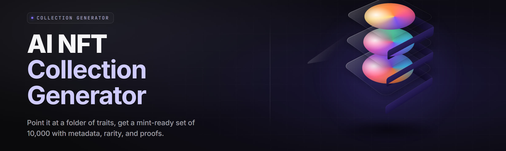

  
  
  

  

  
  

---

**Draft a 10,000-piece generative collection, lock trait rarities, and export a fully compliant ERC-721 metadata pack — offline, on one desktop .exe.**

*Deterministic artwork generation · trait rarity solver · IPFS-ready metadata bundler · provenance ledger export · built for creators who want a collection on-chain by Friday.*

---

## Table of Contents

- [Overview](#overview)
- [What Is an AI NFT Collection Generator](#what-is-an-ai-nft-collection-generator)
- [Key Features](#key-features)
- [The Problem](#the-problem)
- [The Solution](#the-solution)
- [Module Catalog](#module-catalog)
  - [🎨 Artwork Synthesis Modules](#-artwork-synthesis-modules)
  - [🧬 Trait & Rarity Modules](#-trait--rarity-modules)
  - [📜 Metadata & Provenance Modules](#-metadata--provenance-modules)
  - [🗄️ Export & Chain Modules](#️-export--chain-modules)
  - [🧪 QA & Preview Modules](#-qa--preview-modules)
  - [⚙️ Workflow & Pipeline Modules](#️-workflow--pipeline-modules)
- [Tips for Best Results](#tips-for-best-results)
- [Installation](#installation)
- [Quick Start](#quick-start)
- [System Requirements](#system-requirements)
- [Comparison](#comparison)
- [Known Issues](#known-issues)
- [FAQ](#faq)
- [Usage Guidelines](#usage-guidelines)
- [Changelog](#changelog)

---

## Overview

| Category | Details |
|---|---|
| Product | AI NFT Collection Generator — 2026 Toolkit |
| Type | Desktop application (single `.exe`, portable extract-and-run) |
| Primary output | PNG/WebP art layers + ERC-721 JSON metadata + manifest |
| Generator engine | Bundled ONNX diffusion + trait compositor (GPU or CPU) |
| Collection ceiling | 100,000 tokens per project (tested at 10k / 25k / 50k) |
| Trait system | Weighted rarity, conflict rules, mutually-exclusive groups |
| Provenance | SHA-256 layer hash + deterministic seed ledger per token |
| Chain targets | Ethereum, Base, Polygon, Arbitrum (metadata-agnostic) |
| Storage | Local, IPFS pin handoff, Arweave bundle, S3-compatible |

The AI NFT Collection Generator turns a folder of trait layers, a rarity spec, and a prompt stylebook into a deterministic, reproducible 10,000-piece collection. Every token gets art, metadata, a rarity lock, and a hash-verifiable provenance record — generated on your own machine, no account, no upload quota.

## What Is an AI NFT Collection Generator

| Term | Explanation |
|---|---|
| **Trait layer** | A transparent PNG/SVG for one category (eyes, background, hat) composited into the final token. |
| **Rarity weight** | A per-trait probability that drives how often a trait appears across the collection. |
| **Conflict rule** | A constraint preventing incompatible traits from appearing on the same token (e.g. hat + helmet). |
| **Deterministic seed** | A per-token PRNG seed that guarantees the same collection regenerates byte-for-byte. |
| **Metadata pack** | The `N.json` files following the ERC-721 metadata standard, plus a `manifest.json`. |
| **Provenance ledger** | A hash chain recording every layer's content hash, the seed, and the order of composition. |
| **Drop supply** | Total token count for the collection (e.g. 5,000 for a fine-art drop, 10,000 for standard). |

- Generate art + metadata in one pass instead of three separate scripts.
- Lock rarity before render so the marketplace listing matches the art exactly.
- Reproduce any single token deterministically for support tickets or reveals.
- Export to four storage targets without touching a CLI.
- No wallet or account needed to run — the tool is fully offline by default.

## Key Features

| Feature | Description | Benefit |
|---|---|---|
| Diffusion Layer Studio | Prompt + seed per trait layer, batch render 200 variants. | Custom AI art without leaving the tool. |
| Trait Rarity Solver | Weighted probability + conflict matrix, dry-run stats. | Know your rarity curve before you mint. |
| Deterministic Seeded Generation | Fixed PRNG per token, reproducible output. | Verify a reveal or support a refund claim. |
| Metadata Standard Exporter | ERC-721 `N.json` with trait attributes and image link. | Drop-in for any marketplace indexer. |
| IPFS / Arweave Handoff | Bundle + pin manifest, CID written back to metadata. | One-click decentralized storage path. |
| Provenance Ledger | SHA-256 hash chain per token and per collection. | Provable originality at auction. |
| Rarity Report Card | Per-trait rarity, distribution histogram, dup detection. | Catch a boring collection before it ships. |
| Batch Render Queue | Multi-GPU + CPU fallback queue with resume. | 10,000-piece runs survive a crash. |
| Style Guide Lock | Palette, line weight, and prompt token lock. | Consistent look across every trait. |
| Pre-Mint Duplicate Scanner | Pixel+metadata duplicate detection across tokens. | No two identical apes in your drop. |
| Collection Preview Grid | Draft contact-sheet of first 100 tokens. | Approve the vibe before a full render. |
| One-Click Target Export | Chain + storage preset combos. | Ship a collection without a build script. |

## The Problem

- You have 40 trait layers, a rarity doc, and no idea how to turn them into 10,000 compliant tokens without three Python scripts and a weekend.
- Marketplace indexers reject metadata that's missing an `image` key, a proper `attributes` array, or the right attribute format.
- Rarity math is guesswork — a trait you set to 15% ends up at 41% because the conflict rules serialize weirdly.
- AI-generated traits drift in style, so the collection looks like it was drawn by six different artists.
- A reprocessed token can't be proven original — you have no hash record of which layers composed it.
- IPFS upload means uploading 10GB manually, then pasting 10,000 CIDs by hand.
- Reveal-day support requests can't be resolved because rendering isn't reproducible.

## The Solution

| Problem | Solution |
|---|---|
| Manual scripting for a 10k drop | One desktop pass: layers → art → metadata → bundle. |
| Indexer metadata rejection | Standard ERC-721 exporter with validated `image` + `attributes`. |
| Rarity drift | Rarity Solver dry-run with histogram before the real render. |
| Style drift across traits | Style Guide Lock pins palette, weight, and prompt tokens. |
| Unprovable originality | Hash-chained provenance ledger per token and per collection. |
| Manual IPFS upload | Bundled pin/handoff with CID write-back into metadata. |
| Unreproducible reveals | Deterministic seeds stored in the manifest for every token. |

  

## Module Catalog

27 modules across six domains. Each table lists the module, current status, and what it does. Use the tabs in the app to toggle modules on and off per project.

### 🎨 Artwork Synthesis Modules

| Module | Status | Description |
|---|---|---|
| Diffusion Layer Studio | ✅ Working | Prompt + seed UI for generating each trait layer as a batch. |
| Trait Compositor | ✅ Working | Alpha-correct layer stacking with anchor and blend modes. |
| Palette Lock | ✅ Working | Locks a five-swatch palette across every generated layer. |
| Style Transfer Pass | ✅ Working | Optional img2img pass to unify line weight across traits. |
| Resolution Upscaler | ✅ Working | 2×/4× ESRGAN-style upscale with tile-safe memory handling. |
| Background Forge | ✅ Working | Procedural gradient/noise backgrounds as a fallback trait. |

### 🧬 Trait & Rarity Modules

| Module | Status | Description |
|---|---|---|
| Rarity Solver | ✅ Working | Weighted probability model with live distribution preview. |
| Conflict Matrix | ✅ Working | Mutually-exclusive trait groups and pairwise conflict rules. |
| Dup Detector | ✅ Working | Pixel + metadata duplicate scan across the whole collection. |
| Rarity Report Card | ✅ Working | Per-trait rarity, histogram, and outlier warnings. |
| Token Seed Ledger | ✅ Working | Deterministic PRNG seed per token, stored in manifest. |
| Trait Budget Guard | ✅ Working | Caps total trait categories, prevents trait explosion. |

### 📜 Metadata & Provenance Modules

| Module | Status | Description |
|---|---|---|
| ERC-721 Exporter | ✅ Working | Emits `N.json` with `name`, `description`, `image`, `attributes`. |
| Hash Chain Writer | ✅ Working | SHA-256 chain per token layer order and per collection. |
| Provenance Manifest | ✅ Working | Master `manifest.json` with hashes, seeds, and rarity stats. |
| License Stitcher | ✅ Working | Attaches license text to each token's metadata. |
| Collection Minter Sheet | ✅ Working | CSV worksheet for bulk mint via contract or platform UI. |
| Reveal Pack | ✅ Working | Pre-reveal / post-reveal metadata pair export. |

### 🗄️ Export & Chain Modules

| Module | Status | Description |
|---|---|---|
| IPFS Handoff | ✅ Working | Bundles a flat folder and hands off to pinning tooling. |
| Arweave Bundler | ✅ Working | Produces a single bundle plus a manifest for Arweave upload. |
| S3-Compatible Pusher | ✅ Working | Uploads a collection to any S3-compatible bucket. |
| Chain Preset Packs | ✅ Working | Ethereum, Base, Polygon, Arbitrum metadata presets. |
| CID Write-Back | ✅ Working | Rewrites `image` and `animation_url` with the returned CID. |
| Folder Naming Normalizer | ✅ Working | Enforces kebab-case, zero-padded token filenames. |

### 🧪 QA & Preview Modules

| Module | Status | Description |
|---|---|---|
| Preview Grid | ✅ Working | Contact sheet of the first 100 tokens before full render. |
| Rarity Heatmap | ✅ Working | Visual rarity coverage matrix across categories. |
| Metadata Validator | ✅ Working | Schema check against a required-keys list. |
| Render Diff Tool | ✅ Working | Byte-diff between two runs to prove determinism. |
| Lint Report | ✅ Working | Flags missing `image`, empty `attributes`, or orphan files. |

### ⚙️ Workflow & Pipeline Modules

| Module | Status | Description |
|---|---|---|
| Batch Render Queue | ✅ Working | Multi-GPU + CPU fallback queue with crash-safe resume. |
| Project Presets | ✅ Working | Save/load a full project config as a single file. |
| Pipeline Timeline | ✅ Working | Stall-recovery and stage timing for long 10k runs. |

## Tips for Best Results

- Lock your palette and style guide before generating any trait layer — recoloring later means re-rendering the whole set.
- Run the Rarity Solver dry-run first; read the histogram, adjust weights, then commit to the full render.
- Set conflict rules before rendering, not after — retroactive conflicts force a full re-run.
- Keep a single project preset per drop so you can reproduce the exact collection months later.
- Render at 1024×1024 minimum; marketplaces will downscale for thumbnails but upscaling loses detail.
- Use the Dup Detector every time before you export — one duplicate pair can sink a collection's reputation.
- Export the provenance manifest alongside metadata; auction houses and marketplaces ask for it.
- Test the IPFS handoff with a 50-token mock collection before committing to the full 10k.

## Installation

1. **Download the release bundle.** Grab the `.exe` from the project page.
2. **Extract to a local folder.** Windows Defender may flag the unsigned `.exe` — allow it if you trust the source, or add an exception for the extracted folder.
3. **Run the `.exe`.** First launch initializes the bundled runtime and creates a `projects/` folder next to the binary. No Python, no Node, no `pip install` — everything is inside the bundle.

## Quick Start

1. 🎯 **Create a project.** Click *New Project*, name your drop, pick a supply (500 / 5,000 / 10,000 / 25,000).
2. 🖼️ **Import trait layers.** Drag a folder per category (Background, Body, Eyes, Hat, Accessory). Alpha PNG or SVG.
3. 🧬 **Set rarity + conflicts.** Use the Rarity Solver panel. Weights are per-layer; conflicts are pairwise.
4. 🎨 **Generate the collection.** Hit *Render*. The Batch Queue handles 10k tokens in one pass.
5. 📜 **Export metadata + provenance.** Choose a chain preset, then *Export*. Point the IPFS Handoff at your pinning tool.

## System Requirements

| Component | Minimum | Recommended |
|---|---|---|
| OS | Windows 10 x64 (build 1903+) | Windows 11 x64 |
| CPU | 4-core, AVX2 | 8-core / 12-thread |
| RAM | 16 GB | 32 GB |
| GPU | DirectX 12, 6 GB VRAM (CPU fallback supported) | 12 GB+ VRAM (RTX 3060 or better) |
| Storage | 25 GB free (10k collection) | 100 GB NVMe |
| .NET | Bundled — no separate install | Bundled |

## Comparison

| Aspect | Manual Scripts | Web Generators | This Tool |
|---|---|---|---|
| Runs offline | ✅ (if you write it) | ❌ | ✅ |
| Deterministic output | rarely | ❌ | ✅ (seed ledger) |
| Rarity solver + preview | no | limited | ✅ |
| ERC-721 metadata export | you build it | partial | ✅ |
| Hash-chained provenance | no | no | ✅ |
| IPFS/Arweave handoff | manual | paywalled | ✅ |
| 10k render in one pass | fragile | capped | ✅ |
| No account / no upload quota | ✅ | ❌ | ✅ |

## Known Issues

| Issue | Solution |
|---|---|
| Defender flags the `.exe` as unfamiliar | Add an exclusion for the extracted folder or submit for review. |
| Render stalls near token 8,000 | The Batch Queue resumes on relaunch; check VRAM ceiling. |
| Metadata fails indexer validation | Run Metadata Validator first; ensure `image` is non-empty. |
| IPFS handoff times out on 10k folder | Use the chunked upload mode, or pin in batches of 2,500. |
| Style Transfer Pass is slow on CPU | Disable the pass or run on GPU for large collections. |
| Duplicate tokens appear | Re-run Dup Detector; adjust conflict matrix and re-render. |

## FAQ

**Q:** Is this free?
**A:** Yes — the desktop toolkit is a free download. No account, no upload quota, no subscription.

**Q:** Does it upload my art anywhere by default?
**A:** No. The tool is offline by default. IPFS and S3 upload happen only when you click their handoff buttons.

**Q:** Can I reproduce a single token months later?
**A:** Yes — the seed per token is stored in the manifest. Re-run with the seed and you get the same token, byte-for-byte.

**Q:** Which chains does it support?
**A:** Metadata presets for Ethereum, Base, Polygon, and Arbitrum. The metadata is standard ERC-721 and works with any compatible marketplace.

**Q:** Can it generate AI traits or do I need my own layers?
**A:** Both. The Diffusion Layer Studio generates traits from prompts; you can also import your own art layers.

**Q:** Do I need a GPU?
**A:** No — CPU fallback is supported, but a GPU with 12 GB+ VRAM renders a 10k drop in a fraction of the time.

**Q:** Does it mint for me?
**A:** No minting. It exports a Minter Sheet CSV and standard metadata; you mint via your contract or a platform UI.

**Q:** Is there a size limit per collection?
**A:** Tested to 50,000 tokens. Above 25k you'll want the NVMe storage and a GPU.

**Q:** Will a future Windows update break the `.exe`?
**A:** The runtime is bundled, so `.exe` stays portable. Updates to the tool are shipped as new release bundles.

**Q:** Where's the provenance manifest used?
**A:** Auction houses, marketplaces, and collectors use it to verify originality. Ship it inside the collection folder.

## Usage Guidelines

| Allowed | Not allowed |
|---|---|
| Generating original collections you own the rights to. | Using third-party copyrighted art as trait layers without a license. |
| Commercial drops on any chain. | Minting collections with plagiarized metadata or fake rarity claims. |
| Importing your own commissioned art. | Reproducing another creator's exact collection and claiming authorship. |
| Public or private collection releases. | Reselling the toolkit as your own product. |
| Exercising determinism for reveals or support. | Forging provenance hashes to misrepresent originality. |

## Changelog

- **v2.6** — Rarity Solver histogram, Arweave bundler, CID write-back.
- **v2.5** — Deterministic seed ledger, Render Diff Tool, duplicate scanner.
- **v2.4** — Style Transfer Pass, Palette Lock, conflict matrix editor.
- **v2.3** — Diffused Layer Studio, batch render queue, preview grid.
- **v2.2** — ERC-721 exporter, IPFS handoff, chain preset packs.
- **v2.0** — Initial public release with trait compositor.

---

The AI NFT Collection Generator was built for creators who want a drop on-chain without a scripting weekend. Version 2.6 is the current release — download, extract, and run, no installer. Bring your layers, lock your rarity, and ship the collection you've been sketching for months.

  

